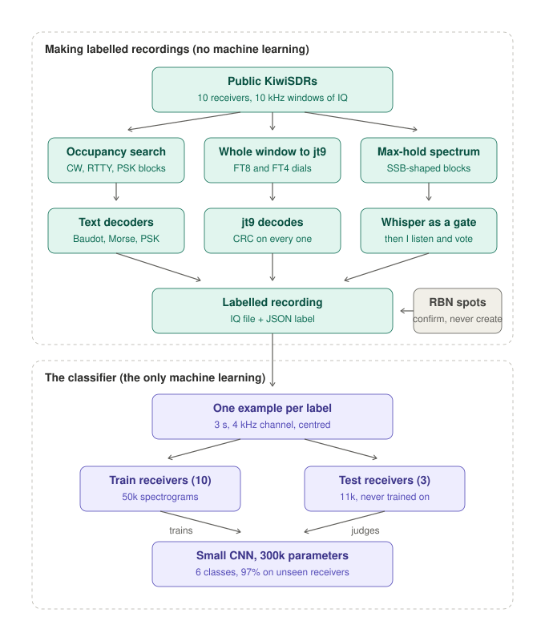
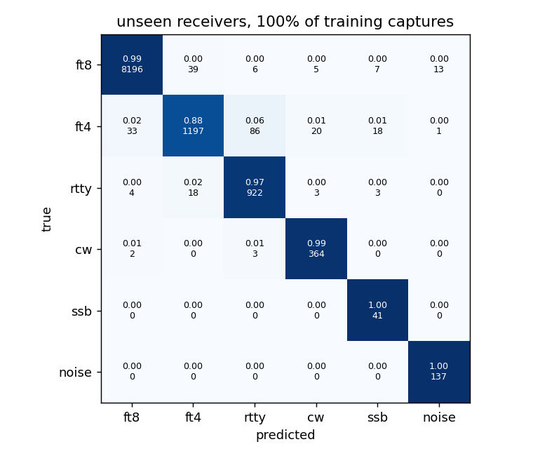
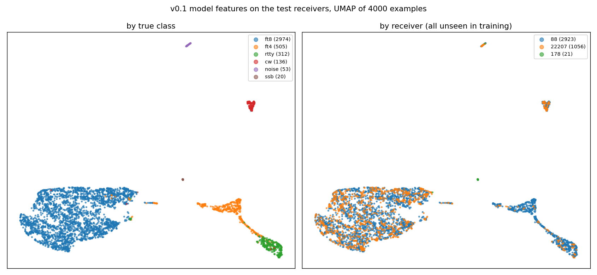

# The Signals Were Real This Time

Back in June I had a classifier that could tell FT8 from RTTY from CW with 99% accuracy. I'd trained it on synthetic signals from generators I'd checked against the real decoders, and measured it against a published synthetic benchmark. I was quite pleased with it. Then I pointed it at a real receiver and it was useless.

Real HF doesn't look like a generator's output. There's fading, splatter from the station next door, a noise floor that's different on every receiver and changes by the hour, operators tuned a hundred hertz off, and contest weekends where a 10 kHz window has a dozen stations in it at once. The model had never seen any of that, so it had no idea what to do with it. In hindsight the 99% was a fact about my generator, not about the air.

This post is about what I did instead, and the first number I'm prepared to stand behind.

## Doing it the other way round

The idea was easy to say and took three weeks to do. Rather than generate signals and hope they look like the air, record the air and let the decoders say what's in it.

Public KiwiSDRs will stream 12 kHz of IQ to anyone who connects. A script keeps a connection to ten of them around Europe and steps through 10 kHz windows on every band, the FT8 and FT4 dials, the CW segments, the data segments, grabbing 20 to 30 seconds of IQ from each. Then each window goes to whatever can decode it. FT8 and FT4 go to WSJT-X's jt9, and since every decode carries a CRC, those windows label themselves. For CW, RTTY and PSK I look for blocks of energy, give each block a narrow channel of its own so the decoder can't drift onto a stronger neighbour, and run a decoder in it. Voice is messier. A max-hold spectrum picks out SSB-shaped blocks and Whisper acts purely as a gate: four distinct words and the clip is kept, after which I listen and vote on it myself. Whisper's transcripts are mostly rubbish, I'm the labeller.

The rule that mattered most is one I got wrong first. A label exists only where a decoder actually read the signal. The Reverse Beacon Network publishes what its skimmers heard, and it was very tempting to use those spots as labels as well. During CQ WW RTTY I let that happen and gained seventeen thousand labels in a day. When I checked, about a third of the RTTY ones had no RTTY at that frequency in my recording. Obvious in hindsight: a skimmer hearing a station says nothing about what my receiver picked up. Spots can now confirm a label I made, by matching the callsign I decoded, but they can't create one.

Three weeks of this, with the laptop asleep for more of it than I'd like, gave me 4,241 recordings from 15 receivers, about 9 GB of IQ, and roughly 28,000 verified labels across FT8, FT4, RTTY and CW, plus a few dozen voted voice clips with a few hundred more waiting for my ears.

## Things I only found by looking

Three faults sat in the pipeline for weeks. Not one of them showed up in a test. All three turned up when a person listened to a clip or looked at a picture.

The first was a click. When I finally played a voice clip through the speakers there was a tick in it every 43 milliseconds. It turned out the KiwiSDR's IQ packets have a 20-byte header and my parser had been skipping 8 bytes since June, so every packet in every recording I'd ever made started with three junk samples. By luck the I and Q pairing survived, so the fix was exact and the old recordings could be repaired. Running jt9 again on the repaired recordings found five times as many FT8 decodes. An impulse every 43 ms turns out to be a very good way of blinding a weak-signal decoder.

The second was my definition of empty. The model needed a noise class, so I took parts of recordings with nothing in them, meaning nothing more than 3 dB above the median of the spectrum. Then I printed a grid of random examples and three of the four "noise" windows had a strong signal in them. In a contest recording the median bin is a signal. The floor has to be a low percentile, and it has to be local, because the receiver's passband falls away at the edges.

The third was that passband. Signals near the edge of a window sit on a sloping floor and signals in the middle don't, and all my noise windows came from the middle. A model would happily have learned that a sloping floor means signal. True of my recordings, false everywhere else. Every class is now cut from the flat part of the passband only.

None of these would have shown up as a low accuracy. Every one of them would have produced a model that worked on my data and failed on yours.

## The experiment

I kept the question narrow. Trained on some receivers, does the model recognise the modes on receivers it has never seen?

For every label I cut a 3-second window of a 4 kHz channel centred on the signal, turned it into a 64 by 187 log spectrogram, subtracted the median and divided by the spread, so gain and noise floor can't be used as features. That window is all the model sees. No bandwidth, no frequency, no metadata. Ten receivers went into training, about 50,000 windows. Three were kept back entirely for testing, about 11,000 windows, and two more for validation. The model itself is small, four convolutional blocks and a linear layer, about 300,000 parameters, and it trains in six minutes on a laptop GPU.

On the three receivers it had never seen:

| Mode | Recall |
|---|---|
| FT8 | 0.99 |
| CW | 0.99 |
| RTTY | 0.97 |
| Noise | 1.00 |
| SSB | 1.00 (41 of 41) |
| FT4 | 0.88 |

That's a balanced accuracy of 0.97. The mistakes make physical sense. FT4 gets confused with RTTY, both of them bursty and a few hundred hertz wide, and a handful of FT4 windows were called voice. The two digital test receivers, one in Ireland and one in Norway, agree with each other to within a point on every class except FT4.

I also tried training on a quarter of the recordings, then half, then all of them: 0.975, 0.982 and 0.972. The curve is flat. For these modes at these signal strengths, 700 recordings were enough and the other 2,000 added nothing, which is useful to know before I spend another three weeks collecting.

The errors also know they're errors. The model's confidence on the 261 mistakes has a median of 0.53, against 0.93 on the 10,857 it got right. A classifier that says "not sure" rather than guessing is the one I'd want in a live tool, and this one can be made to do that with a threshold.

## The picture I actually wanted

The number I was most nervous about wasn't the accuracy. It was whether the model had learned modes or learned receivers. Every voice clip in the set came from receivers that carried no other class at all, and a model can get surprisingly far just by recognising a noise floor it has seen before. Holding out whole receivers is the test for that, and the plot below is the same test drawn.

On the left the modes form islands, with FT4 and RTTY joined by a bridge, which is exactly where the confusion matrix said the mistakes were. On the right the two receivers are mixed together inside every island. If it had learned receivers, each island would be two colours side by side. It hadn't. That was the plot I was most relieved to see.

## What this doesn't show

Every label in the set is a strong signal, because the decoders that made the labels needed a clean copy, and the cutter insists the signal is at least 6 dB above the floor of its window. Below that, nothing has been tested. FT8 and CW still score 98% in the 6 to 9 dB bin; RTTY and FT4 drop to the low 80s. Weak signals are the next experiment, and the honest way to do it is to mix noise recorded from empty windows into signals that were decoded, so the label stays true as the SNR goes down.

Voice is thin: 47 training examples and 41 test examples. The 41 of 41 is encouraging but not yet evidence of much. Modes I can't decode, PSK31, Olivia, MFSK and the rest, aren't in there, so the model has never been asked to say "none of the above". And the judges were three European KiwiSDRs. My own radios, and anyone else's, are untested.

So 97% is a real number, measured the way I should have measured the first one, and it comes with a list of things it doesn't cover. I'd rather have that than the 99% from June.

## What I'd tell myself in June

Collect the real data first. The model was never the hard part; a small network that trains in six minutes did this. The three weeks went on finding and labelling signals, and on the three faults above, each of which I found only because I looked at the examples instead of the accuracy. If there's one habit to take away it's that one. Before you trust a number, print a grid of what the model is being fed, and listen to one of them.

I'm planning to release the recordings and labels, as IQ and mode labels only, because as far as I can find there isn't a labelled real-HF dataset in the open and everyone trying this is building their own from nothing. The code and a fuller write-up will follow. If you have a receiver that can produce IQ and fancy adding to it, get in touch.


